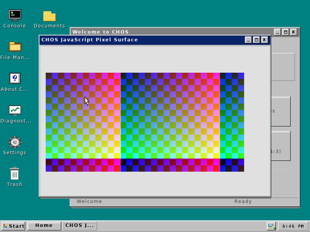

# CHOS native JavaScript pixel checkpoint — 0.30.0

Tested source: `32b31abeb8bc3aa727705f5720ecda26edb0e1b4`.
Stage 3 is incomplete. This milestone displays complete owned images in isolated
windows and actual JavaScript-generated typed-array pixels. WebCore and the full
HTML/CSS browser are still unfinished.

- [Normal installation ISO](CHOS-Fusion-32b31ab.iso?raw=1)
- [JavaScript pixel diagnostic ISO](CHOS-Native-Pixels-32b31ab.iso?raw=1) — **no installer**
- [Engine source, SDK, objects and relinking handoff](CHOS-Fusion-32b31ab-Handoff.zip?raw=1)
- [Exact CHOS source archive](CHOS-32b31ab-source.zip?raw=1)
- [Prepared distribution disk](CHOS-32b31ab-prepared.img.gz?raw=1)
- [Direct kernel](CHOS-32b31ab-kernel-direct.elf.gz?raw=1), [UEFI kernel](CHOS-32b31ab-kernel-uefi.elf.gz?raw=1), [EFI loader](BOOTAA64.EFI?raw=1)
- [Fusion checklist](TESTING.md), [clean binary verification](VALIDATION.json), [source qualification](SOURCE-VALIDATION.json), [rebuild/relink records](ENGINE-REBUILD.json)
- [SHA256SUMS](SHA256SUMS), [manifest](manifest.json)

In the **pixel diagnostic**, open Console and run `run /bin/jscvm.elf` without
arguments. Press Space in its window to change colors; Escape closes it. Repeat
three times and check the completion/cleanup messages. The previous a89db07
standards executable and its five commands remain separately available; those
commands are not modes of this new pixel client.

24 guest profiles plus full host/ASan/UBSan checks pass. Extracting this handoff,
recompiling its client and relinking produces the exact qualified executable.
The full original engine source/notices and SDK/object material accompany the
companion CHOS source ZIP; retain both packages. No mutable test disks are included.
Verify SHA256SUMS and decompress `.gz` files before use.

Independent Fusion execution of this new build is **NOT RUN**. Earlier Fusion
Ethernet success is user-reported evidence. Physical Pi5/laptop tests and native
Wi-Fi remain open, as do production browser policy and full revised Stage3 gates.
Use the normal ISO for installation/persistent storage/restart/shutdown tests.
Destructive installation requires explicit target selection and confirmation.
Version0.50.0 is reserved for complete revised Stage3 acceptance.
