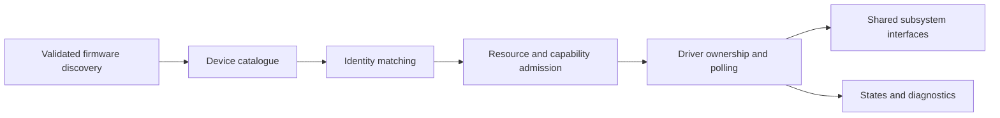

# Modular driver acceptance

Hardware support is selected through a reusable registry plus small bus/driver
adapters. It is intentionally bounded; accepting a transport is different from
receiving input or mounting a filesystem. Unsupported devices stay visible in the
report. The existing direct QEMU MMIO backend remains intact.

## Interfaces and boundaries

| Component | Responsibility |
|---|---|
| `include/chos/driver_registry.h` / `kernel/platform/driver_registry.c` | PCI/FDT identities, priority, startup phases, one owner per identity, clean refusal/failure states, polling and bounded capacity |
| `kernel/platform/drivers.c` | Built-in adapter registrations; current PCI VirtIO and xHCI bindings; firmware discovery remains separate |
| `kernel/platform/pci.c` | Configuration access, assigned BAR sizing, firmware CPU/bus translation, RAM-conflict validation |
| `include/chos/xhci_compat.h` | Explicit, narrowly matched deviations; VMware 15ad:077a compact version normalization; all ordinary checks still apply |
| `kernel/platform/usb.c` / `usb_hid.c` | USB configuration/report policy and normalized input; unsupported functions remain unclaimed |
| `kernel/platform/clock.c` | UEFI time snapshot/counter and explicitly bound FDT RTC sources |
| `kernel/platform/driver_report.c` | Bounded read-only reporting, admission/capability separation and input-recovery decision |

The boot adapter catalogues up to 64 PCI functions and registers up to 16 drivers.
Phase 0 admits transports before storage/network initialization. Phase 1 initializes
input after the GUI exists, so early HID reports have a valid destination. Drivers
are sorted by descending priority; equal priorities retain registration order.
Repeated probing never resets an already bound or failed device. Replacing an
identity at the same BDF is rejected; PCI hot replacement is not implemented.

A pure `matches` callback checks PCI class/IDs or FDT compatible data, without
register accesses. `start` validates resources and supported capabilities, then
returns one of:

* `UNSUPPORTED`: clean refusal before ownership, so a lower-priority adapter may try.
* `READY`: the adapter owns a working transport. Higher-level service and actual
  event/I/O evidence remain separate; controller-running is not keyboard-working.
* `FAILED`: initialization may have touched hardware. No fallback may rebind it;
  uncertain DMA remains reserved/quarantined. Built-in BAR-probing failures use this
  conservative result because partial hardware mutation cannot be ruled out.

`poll` services only ready bindings. `stop` runs in reverse order, once per owned
binding. A driver must provide its own bounded reset/command waits and shutdown;
the registry cannot make an arbitrary hardware operation safe. Static storage and
single-core serialization are current contracts, not an SMP or IOMMU API.

The VirtIO PCI adapter adds validated device transports individually, then seals
bindings before queue drivers run. Duplicate BDF admission returns its original
opaque handle. No slot is replaced or appended after sealing. MMIO/PCI mixed
transport operation remains unsupported. Native xHCI currently owns one controller;
its USB devices/interfaces have independent bounded hotplug state beneath that
controller. The reusable registry also tests FDT matching, but the default boot
catalogue currently attaches PCI drivers; new FDT adapters need discovery glue.

## Adding support

1. Add a driver module implementing `chos_driver_ops_t` and the existing shared
   subsystem interface. Use `chos_driver_match_pci` or `chos_driver_match_fdt` for
   ordinary identity matching. Add exceptional hardware rules to the relevant
   family's explicit compatibility table, with evidence and a narrow regression.
2. Validate firmware resources in `start`; never derive an MMIO address from a
   vendor ID. Check BAR size/translation, cache/DMA/addressability, IOMMU ownership,
   controller capabilities and wait budgets before starting queues. Refuse cleanly
   before hardware mutation, or return failed ownership after uncertain mutation.
3. Register the ops in `drivers.c` before the first probe and include the module in
   Makefile sources. Pick phase/priority explicitly. A new PCI implementation does
   not require editing `kernel_main` or the GUI. A new bus enumerator adds validated
   identities before probing; the matching/probe/report lifecycle stays reusable.
4. Implement normalized events, block operations, networking or entropy through the
   shared subsystem API. Do not inject ASCII for keyboard support or synthesize
   fallback entropy. Track real functional capability separately from transport
   readiness; retain useful failure details.
5. Add portable tests for match/refusal, malformed resources, lost/bad completion,
   repeated initialization and teardown, followed by live testing on a disposable
   emulator/target. Generic support claims require actual target evidence.

## USB and recovery behavior

USB HID admission accepts bounded endpoint padding while interpreting only the
descriptor-defined payload. Unknown IDs and short/oversized reports are rejected.
Admission uses descriptors and usages, rather than a VMware peripheral-ID
allowlist. A vendor/consumer-only function cannot reject a usable keyboard/pointer
on the same device. Report IDs and interfaces retain held state; USB source counts
prevent one interface from releasing another's held key/button. Modifiers precede
letters. A composite physical pointer prefers its recent absolute stream over its
relative duplicate; independent mice remain independent.

Each endpoint keeps eight independent interrupt-IN buffers queued, matching the
reference's receive strategy. The 1024-entry event segment is aligned to 16 KiB so
it cannot cross a 64 KiB DMA boundary. All receive buffers are individually aligned;
Disconnect/Disable Slot cancels them before reuse. No-input NAK does not wait, trace
or allocate. A strict mock rejects output-only endpoint/slot state in input contexts;
those fields are now cleared for EP0 evaluation and endpoint configuration.

When keyboard or pointer admission is missing for five seconds, the normal ISO
opens a diagnostic window and rotates pages every three seconds. Architectural
counter timing works even in the IRQ fallback. No key, serial port, second image
or storage access is required to inspect it. It shows the clock source, timer ticks,
aggregate event counts, PCI binding/driver/reason, raw xHCI layout and current USB
control/enumeration stage. It never logs typed input or report contents. Once opened,
it does not repeatedly steal Console focus. Console `drivers` opens the same view;
`clock` prints clock source/seconds; `pci` and `bootlog` retain the older reports.

Limits remain explicit: no general IOMMU, PCI resource allocator/hotplug, multiple
native xHCI controllers, arbitrary USB classes/streams or custom protocol speed IDs.
USB/peripheral support is added within its family adapter; the registry does not
claim to make those missing implementations universal.
